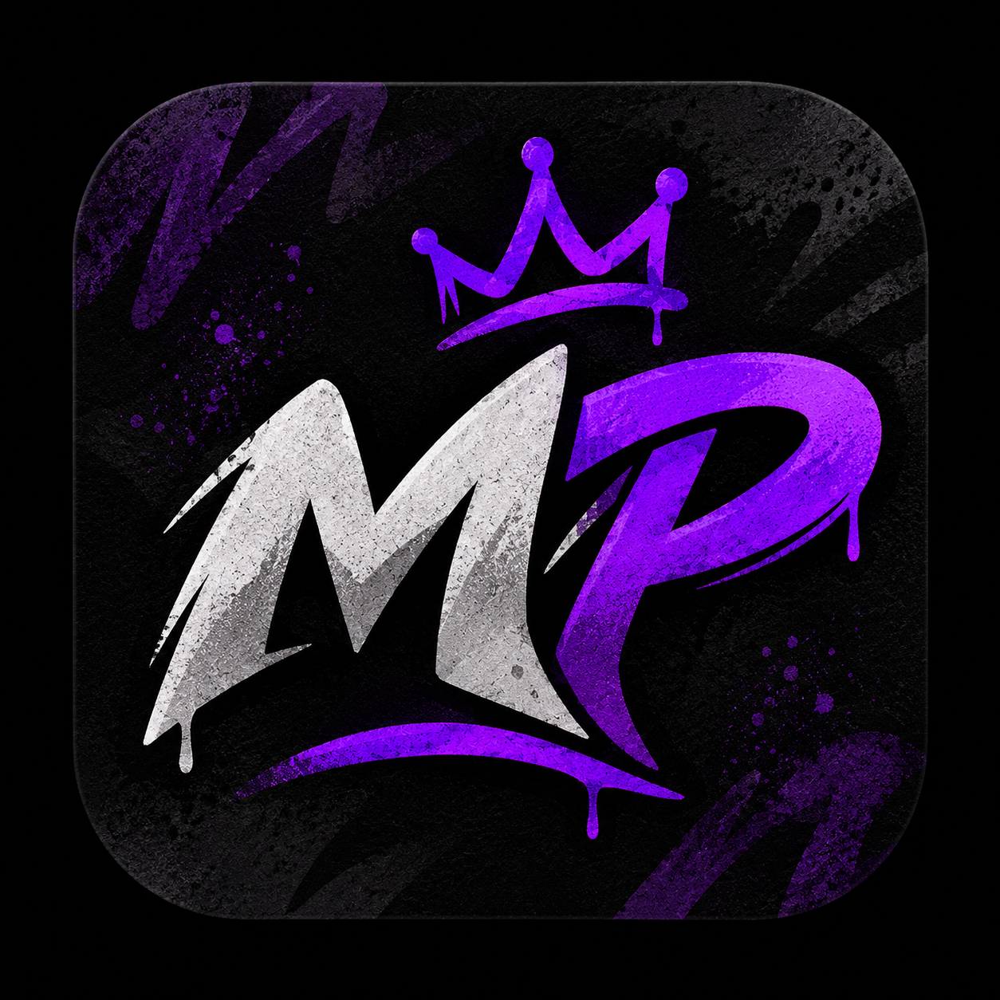

# 🎵 MyatoPlayer — Reprodutor de Música 100% Offline e Local

**MyatoPlayer** é um aplicativo Android completo, moderno e comercial, focado em **privacidade e operação 100% offline**. Combina o design refinado de plataformas como Spotify e Apple Music com um sistema de perfil totalmente local, sem qualquer dependência de nuvem ou Firebase.

---

## 📲 Download do APK

O aplicativo está compilado e pronto para instalação imediata no seu celular Android:

- **Arquivo no projeto:** `./MyatoPlayer.apk` ou `app/build/outputs/apk/debug/app-debug.apk`
- **Tamanho:** ~30 MB (Reduzido após remoção do Firebase)
- **Compatibilidade:** Android 7.0 (API 24) até Android 15 (API 36)

Para instalar:
1. Baixe o arquivo `MyatoPlayer.apk`.
2. No seu aparelho Android, toque no arquivo e confirme a instalação.
3. Abra o **MyatoPlayer** e aproveite suas músicas com som equalizado e total privacidade!

---

## ✨ Funcionalidades Principais

### 1. 🔒 100% Local & Offline
- **Sem Cloud**: Todas as dependências do Firebase foram removidas. Seus dados nunca saem do dispositivo.
- **Perfil Local**: Crie seu perfil de usuário diretamente no app para personalizar sua experiência sem precisar de conta Google ou internet.

### 2. 🧭 Navegação Profissional
1. **Início (Home)**: Card "Continuar Ouvindo", carrosséis de "Tocadas Recentemente", "Mais Ouvidas" e recomendações inteligentes locais.
2. **Biblioteca (Library)**: Gestão de arquivos locais com filtros rápidos e Smart Picks (Sugestões geradas localmente).
3. **Explorar**: Busque milhões de músicas gratuitas através das APIs do Jamendo e SoundCloud para reprodução instantânea (Requer internet para busca).
4. **Playlists**: Criação ilimitada de listas personalizadas salvas no banco de dados Room.
5. **Configurações**: Equalizador, Temporizador de Sono e ajustes de desempenho.

### 3. 🧠 Smart Picks (IA Local)
- Sistema de sugestões que analisa seus artistas favoritos e sugere novos estilos e mixes, operando totalmente offline para sua conveniência.

---

## 🛠️ Arquitetura e Tecnologias

- **Linguagem**: Kotlin 100%
- **Interface**: Jetpack Compose com Material Design 3 (M3)
- **Áudio**: AndroidX Media3 (`ExoPlayer`)
- **Banco de Dados**: Android Room Database (Local)
- **Preferências**: Jetpack DataStore (Perfil e Ajustes)
- **Arquitetura**: MVVM (Model-View-ViewModel) + Offline-First

---

## 🚀 Compilação Automática (CI/CD)

Este projeto está configurado para compilação via **GitHub Actions** sem necessidade de segredos ou chaves externas.

1. **Push para o GitHub**: O código será compilado automaticamente.
2. **Releases**: Crie uma tag (ex: `v2.0.0`) para gerar o APK final na seção de Releases do seu repositório.

O MyatoPlayer agora é mais leve, mais rápido e totalmente privado!

